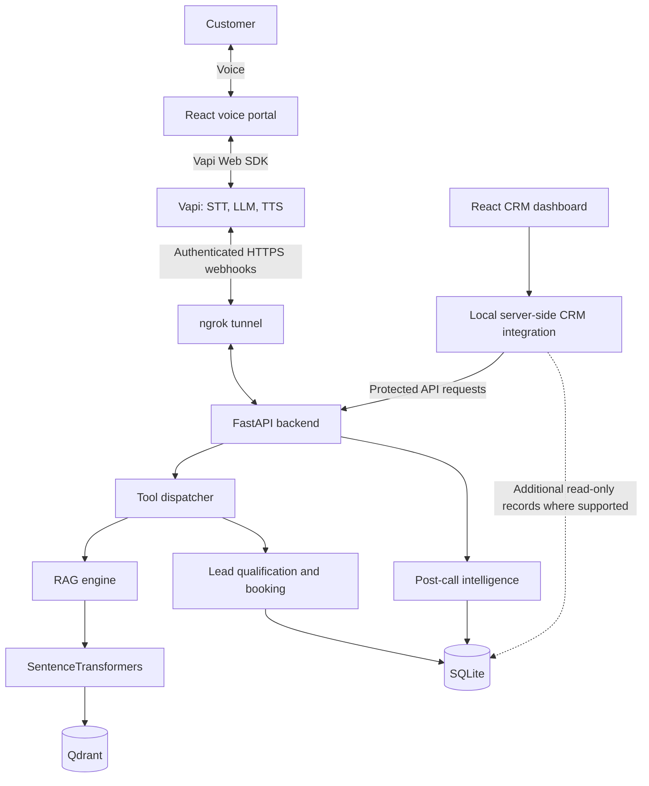

# nova-Pilot

**From conversation to conversion.**

An autonomous AI sales voice agent and CRM platform developed for the **Fortivex AI technical assignment**.

nova-Pilot automates customer enquiries, lead qualification, appointment scheduling and post-call intelligence through real-time voice conversations. The MVP demonstrates an education admissions use case through **NovaSkill Academy** and its AI counsellor, **Alex**.

## Problem statement

Sales teams spend considerable time answering repetitive questions, collecting customer information, qualifying prospects, scheduling consultations and updating CRM records. nova-Pilot brings these activities into one conversational workflow, allowing the agent to execute real business operations rather than merely generate responses.

## Features

- Real-time browser-based AI voice conversations using Vapi.
- Customer voice portal with call controls, microphone management and live transcripts.
- Retrieval-augmented generation (RAG) grounded in business-specific knowledge.
- Autonomous function calling for lead capture, availability, booking and escalation.
- Explainable, deterministic lead qualification and scoring.
- Appointment persistence with duplicate-booking protection and explicit customer confirmation.
- Post-call summaries, sentiment, objections and recommended next actions.
- React-based CRM dashboard for business records and analytics.
- Authenticated webhooks and protected administrative APIs.
- Automated booking tests.

## Architecture



Vapi manages the real-time voice orchestration. FastAPI owns business rules, tool execution and persistence. The frontend consumes the existing backend contracts rather than duplicating business logic.

## Technology stack

| Layer | Technology |
|---|---|
| Frontend | React, TypeScript, Vite |
| Voice orchestration | Vapi Web SDK and Vapi assistant |
| Backend | Python, FastAPI, Uvicorn |
| Validation | Pydantic |
| ORM | SQLAlchemy |
| Database | SQLite |
| Vector database | Qdrant (embedded/local) |
| Embeddings | SentenceTransformers, `all-MiniLM-L6-v2` |
| Local webhook connectivity | ngrok |
| Testing | pytest |

The STT, LLM and TTS providers are configured in the existing Vapi assistant; they are not independently implemented by nova-Pilot.

## Agent workflow

1. A customer starts a voice conversation with Alex.
2. Vapi transcribes speech and passes the conversation context to its configured LLM.
3. The LLM selects a business tool when an action or grounded answer is required.
4. Vapi sends an authenticated webhook to FastAPI.
5. The backend validates tool arguments, executes business logic and returns the result.
6. Vapi generates and speaks the response.
7. Customer information and confirmed appointments are persisted in SQLite.
8. After the call, structured conversation insights are extracted and saved.
9. The CRM displays the resulting business records.

### Autonomous tools

| Tool | Responsibility |
|---|---|
| `search_knowledge` | Retrieve relevant business information from Qdrant |
| `update_lead` | Create or progressively update the lead associated with the call |
| `check_availability` | Return available future consultation slots |
| `book_appointment` | Persist a confirmed appointment after validating the lead and slot |
| `escalate_to_human` | Create a persistent human follow-up request |

Human escalation records are follow-up requests, not a live call transfer or proof of notification.

## RAG pipeline

Business knowledge is stored in `knowledge_base/courses.json`. The ingestion script embeds each record and stores its vector and associated content in Qdrant. At runtime, the query is embedded using the same model and relevant records are returned to the assistant.

| Parameter | Configuration |
|---|---|
| Model | `all-MiniLM-L6-v2` |
| Dimensions | 384 |
| Similarity | Cosine |
| Collection | `novaskill_knowledge` |
| Maximum retrieved records | 3 |
| Score threshold | 0.35 |

Retrieval grounds responses in business information, but does not guarantee that every generated answer is correct. The assistant should avoid inventing information when retrieval is insufficient.

## Lead qualification

The LLM extracts customer information; the backend calculates the score using deterministic rules.

| Factor | Maximum points |
|---|---:|
| Interest: high / medium / low = 30 / 15 / 0 | 30 |
| Budget: full fee / at least 70% / below 70% = 30 / 15 / 0 | 30 |
| Timeline: immediate or within 30 days / within 90 days / later = 25 / 10 / 5 | 25 |
| Phone or email available | 15 |
| **Total** | **100** |

| Classification | Rule |
|---|---|
| Hot | Score ≥ 75 |
| Warm | Score 45–74 |
| Cold | Score below 45 |
| Qualifying | Course, interest, budget or known timeline is missing |

This separation makes scoring consistent and explainable. The weights are MVP business rules, not a statistically calibrated conversion prediction model.

## Booking and data persistence

Booking requires explicit customer confirmation, a saved lead with a name and at least one contact method, and a valid future slot. A unique database constraint on `slot_id` prevents duplicate bookings. The backend handles integrity errors and rolls back failed transactions. Repeated requests for an existing valid booking by the same lead can return the existing appointment.

Appointment slots are stored in UTC and formatted in IST for customer-facing availability responses.

### Data model

| Table | Purpose |
|---|---|
| `leads` | Customer information, qualification score and status |
| `calls` | Call transcript, summary, sentiment and metadata |
| `appointment_slots` | Counsellor availability |
| `appointments` | Confirmed customer bookings |
| `escalations` | Human follow-up requests |
| `call_insights` | Objections and recommended next action |

The call ID connects conversational events to persistent customer records. The MVP does not implement cross-call identity resolution or long-term personalised agent memory.

## Repository structure

```text
novaSkillAcademy-pilot/
├── backend/
│   ├── main.py          # FastAPI entrypoint and REST endpoints
│   ├── config.py        # Environment configuration
│   ├── database.py      # SQLAlchemy engine and sessions
│   ├── models.py        # Database models
│   ├── schemas.py       # Pydantic validation
│   ├── webhook.py       # Vapi authentication and event handling
│   ├── tools.py         # Tool dispatcher
│   ├── rag.py           # Semantic retrieval
│   ├── qualification.py # Lead scoring
│   ├── booking.py       # Availability and booking
│   └── analysis.py      # Post-call structured output extraction
├── frontend/           # React voice portal and CRM
├── knowledge_base/
│   └── courses.json
├── scripts/
│   ├── ingest.py
│   └── seed_slots.py
├── tests/
│   └── test_booking.py
├── .env.example
└── requirements.txt
```

## Getting started

### Prerequisites

- Python compatible with the dependencies in `requirements.txt`
- Node.js and npm compatible with the frontend's Vite version
- ngrok installed and authenticated
- Existing Vapi assistant with its five function tools configured

### 1. Clone and install

```powershell
git clone https://github.com/Vaibhavmohanty25/novaSkillAcademy-pilot.git
cd novaSkillAcademy-pilot
python -m venv .venv
.\.venv\Scripts\Activate.ps1
python -m pip install -r requirements.txt
```

### 2. Configure environment variables

Create a root `.env` from `.env.example` and replace the placeholders with your own values:

```dotenv
APP_NAME=nova-Pilot
DATABASE_URL=sqlite:///./salespilot.db
ADMIN_API_KEY=replace_with_random_secret
VAPI_PUBLIC_KEY=replace_with_public_key
VAPI_PRIVATE_KEY=
VAPI_ASSISTANT_ID=replace_with_assistant_id
VAPI_WEBHOOK_SECRET=replace_with_random_secret
```

Generate independent secrets with `python -c "import secrets; print(secrets.token_hex(32))"`. The private Vapi key is optional for the current backend, which does not directly call the Vapi management API.

Create `frontend/.env.local`:

```dotenv
VITE_VAPI_PUBLIC_KEY=replace_with_public_key
VITE_VAPI_ASSISTANT_ID=replace_with_assistant_id
```

Never place private credentials in browser-accessible environment variables. Do not commit either environment file or the database.

### 3. Initialise knowledge and appointment slots

From the project root, with the virtual environment active:

```powershell
python -m scripts.ingest
python -m scripts.seed_slots
```

Run ingestion only for initial setup or intentional knowledge updates: it recreates the existing vector collection. The slot seeding script creates future slots over the next seven days without duplicating existing slot IDs.

### 4. Start the application

Keep three terminals running simultaneously.

**Terminal 1 — Backend (project root)**

```powershell
.\.venv\Scripts\Activate.ps1
python -m uvicorn backend.main:app --port 8000
```

Use one backend process with embedded Qdrant; do not enable multiple workers against the same local vector storage.

**Terminal 2 — Webhook tunnel**

```powershell
ngrok http 8000
```

Configure the Vapi assistant server URL and each function tool server URL to use the active tunnel:

```text
https://YOUR-NGROK-DOMAIN/api/vapi/webhook
```

Configure the existing webhook credential to send `Authorization: Bearer <VAPI_WEBHOOK_SECRET>` (or the supported `X-Vapi-Secret` header). Attach the Sales Call Intelligence structured output to the assistant, including summary, sentiment, objections and next_action. Enable the required client transcript events for the voice interface.

**Terminal 3 — Frontend (project root)**

```powershell
cd frontend
npm install
npm run dev
```

Restart Vite after changing `.env.local`. Do not expose the local CRM development server through ngrok.

### Application URLs

| Interface | URL |
|---|---|
| Voice portal | http://127.0.0.1:5173/voice |
| CRM dashboard | http://127.0.0.1:5173/dashboard |
| API documentation | http://127.0.0.1:8000/docs |
| Backend health | http://127.0.0.1:8000/health |
| ngrok inspector | http://127.0.0.1:4040 |

## Backend API reference

| Method | Endpoint | Authentication | Purpose |
|---|---|---|---|
| GET | `/` | None | Service information |
| GET | `/health` | None | Health check |
| GET | `/api/leads` | X-Admin-Key | Lead records |
| GET | `/api/calls` | X-Admin-Key | Call records |
| GET | `/api/appointments` | X-Admin-Key | Appointment records |
| POST | `/api/knowledge/search` | X-Admin-Key | Knowledge retrieval |
| POST | `/api/vapi/webhook` | Webhook credential | Tool calls and post-call events |

The CRM integration uses a local server-side proxy so that the administrative key stays out of browser code. Additional CRM records not covered by the original REST endpoints must be retrieved through the frontend integration layer, not invented or exposed through unauthenticated public endpoints.

## Testing and demonstration

Run the existing booking test suite from the project root:

```powershell
python -m pytest tests/test_booking.py -v
```

Frontend validation:

```powershell
cd frontend
npm run build
npm run lint
```

### Live demo scenario

Use fictional customer details for the demonstration:

1. Open the voice portal and start a conversation.
2. Ask Alex about the AI and Machine Learning course fees.
3. Provide a name, email, course preference, budget and enrolment timeline.
4. Ask for an available consultation and explicitly confirm a slot.
5. End the call and allow the post-call report to arrive.
6. Open the CRM and check the lead, qualification status, appointment, summary and sentiment.
7. In a separate conversation, request human assistance and verify the escalation record.

Test invalid credentials, missing customer information, expired slots, duplicate booking attempts, microphone denial and backend connectivity failures. Live voice calls require the configured Vapi account and may incur provider charges.

## Security and privacy

- Webhook requests are checked against a configured shared secret.
- Administrative endpoints require `X-Admin-Key`.
- Pydantic validates tool inputs; business rules are enforced server-side.
- Database constraints protect appointment uniqueness.
- Private credentials remain server-side; the CRM is intended for a loopback-only local demonstration.
- Customer contact details and transcripts should be treated as personal data, with consent, access restrictions and a retention policy in production.

The local proxy is not production-grade user authentication. Production deployment would require role-based access, tenant isolation, rate limiting, secret management, webhook replay protection and audited access to customer records.

## Business feasibility

The system is applicable to education admissions, SaaS sales and other appointment-driven businesses. Its value proposition is reducing repetitive sales work, responding to enquiries promptly and creating actionable lead records automatically.

A potential commercial model is a subscription per business with usage-based billing for voice minutes. The main variable costs are voice transcription, synthesis, LLM inference and telephony if introduced; hosting, database and support contribute additional costs. Actual pricing and margins depend on provider rates and usage patterns and have not been validated in this MVP.

Suggested success metrics include lead capture completeness, confirmed bookings per qualified lead, tool success rate, call latency, escalation rate and cost per successful booking. Appointments are not equivalent to completed sales.

## Scaling to 100,000 users

The current implementation is a local single-business MVP, not a system load-tested for 100,000 users. A production design would include:

| Current MVP | Production evolution |
|---|---|
| SQLite | PostgreSQL with connection pooling and migrations |
| Embedded Qdrant | Dedicated vector database service with tenant filters |
| Single backend process | Horizontally scaled stateless FastAPI instances |
| Local ngrok tunnel | Managed HTTPS ingress/API gateway |
| Inline event processing | Durable queues for non-interactive post-call work |
| Local CRM proxy | Authenticated, role-based multi-tenant CRM |
| Basic logging | Centralised metrics, tracing and alerting |

Interactive tool calls should remain latency-sensitive and return promptly; post-call reporting can be processed asynchronously with retries and idempotency. Capacity planning should distinguish registered users from peak concurrent calls and account for provider quotas, calls per second, database writes and latency objectives. Load testing and cost measurements are required before making scale guarantees.

## Limitations and future scope

- Browser-based voice MVP; PSTN inbound/outbound telephony is not implemented in the current scope.
- Human escalation is stored for follow-up rather than transferred live.
- Native CRM and local appointment scheduling; external CRM and calendar sync are future extensions.
- Multilingual performance depends on configured voice providers and requires language-specific evaluation.
- Production authentication, tenant isolation, automated notifications and distributed deployment remain future work.
- RAG quality, lead scoring effectiveness and production throughput require systematic evaluation.

## Author

**Vaibhav Mohanty**  
B.Tech Computer Science and Engineering (AI & ML)  
Lovely Professional University

GitHub: [Vaibhavmohanty25](https://github.com/Vaibhavmohanty25)

---

Developed as a functional AI voice and CRM MVP for the Fortivex AI technical assignment.
